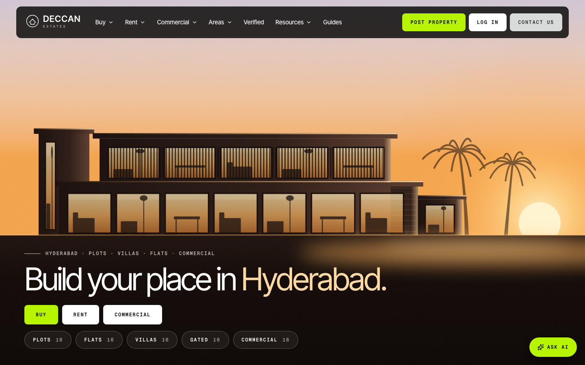
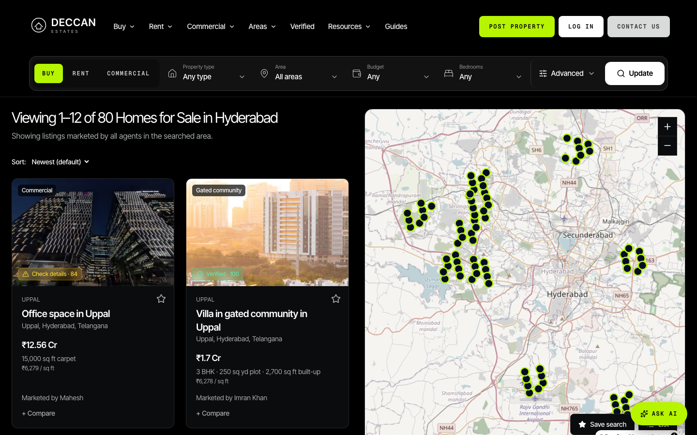
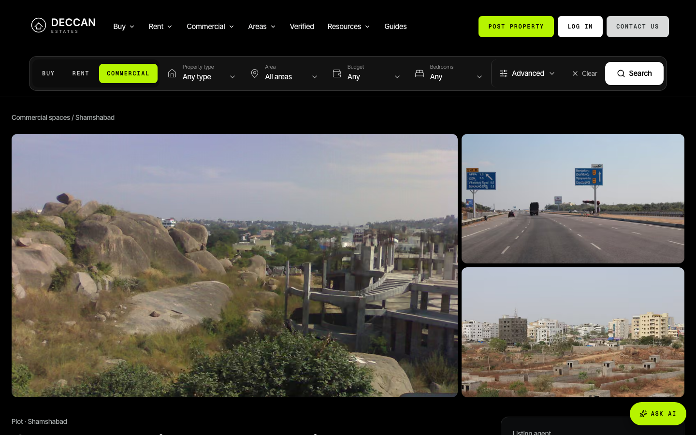
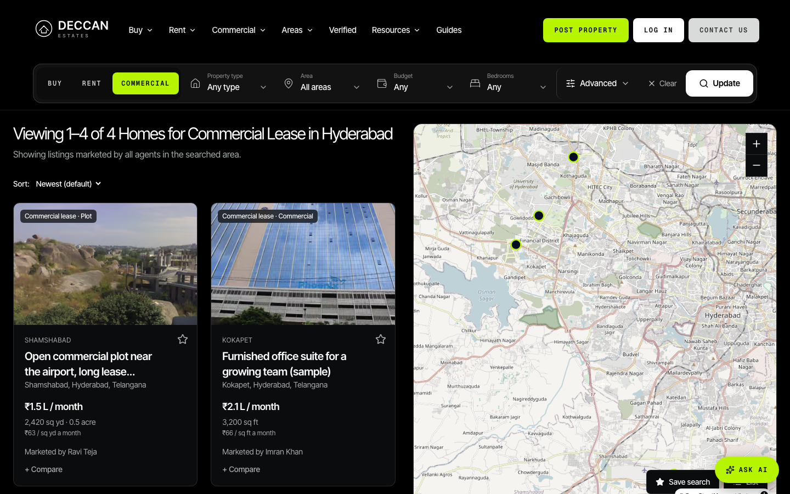
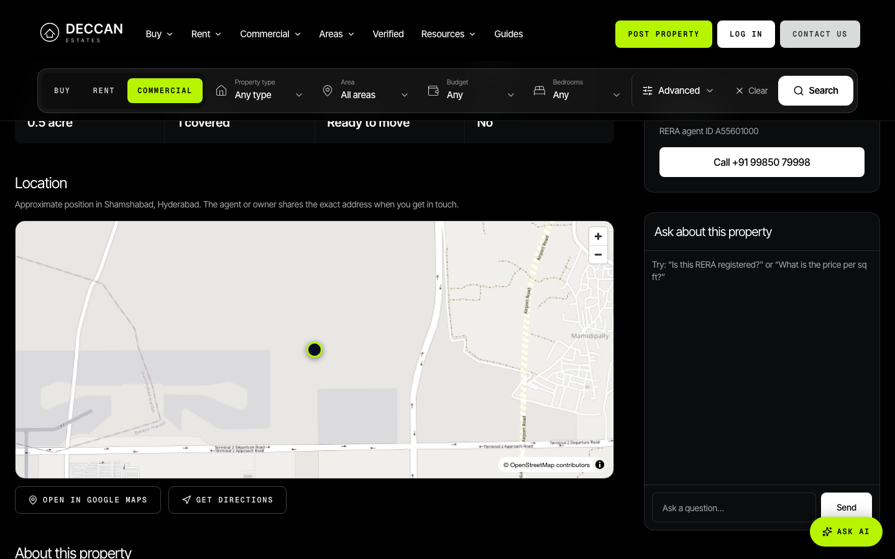
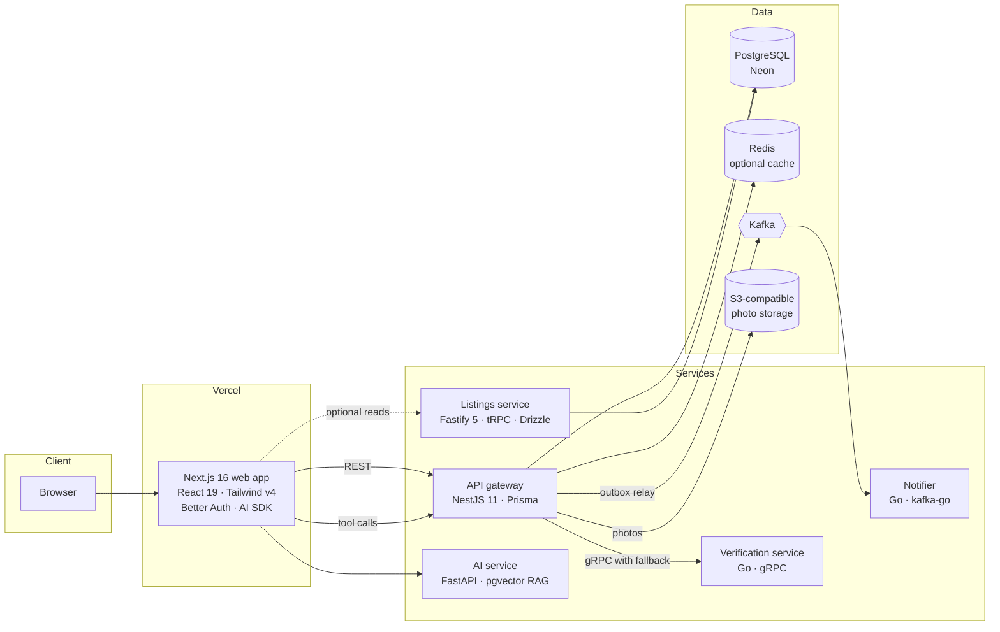

<div align="center">

# Deccan Estates

**A full-stack, polyglot real-estate platform for Hyderabad: search, verified listings, owner posting, and an AI assistant that searches live inventory with tools.**

[](https://github.com/yashwanthvarma74-ai/deccan-estates/actions/workflows/ci.yml)
[](LICENSE)


[Live demo](https://deccan-estates-zeta.vercel.app) · [Architecture](#architecture) · [Design decisions](#design-decisions) · [Quick start](#quick-start) · [Tech-stack guide (PDF)](docs/Deccan-Estates-Tech-Stack.pdf)



</div>

---

## Why this project exists

Property portals in Indian cities mix plots, flats, villas and commercial space with very uneven data quality. Deccan Estates explores what a cleaner version looks like:

- **Trust is a feature.** Every listing can carry a *verification report* (RERA, title, approvals, encumbrance, and so on) produced by a dedicated service, not a text field.
- **Owners can post directly**, with photos, for sale, rent or commercial lease.
- **Search is conversational as well as filtered.** An assistant answers questions by calling typed tools over the real inventory, and degrades gracefully to a deterministic search when no model is available.
- **It is engineered like a system, not a page.** Several services in different languages communicate over HTTP, gRPC and Kafka, with explicit parity tests, an outbox for reliable events, and fallbacks at every network boundary.

> **Honest scope note.** The listings are *sample data* seeded for demonstration (80 sale, 6 rent, 4 commercial lease, across Hyderabad localities). Contact details are placeholders. This is a portfolio and learning project, not a live marketplace. It was built with substantial help from an AI coding assistant (Claude Code); design direction, requirements and review were mine, and I can explain every part of it.

## Screenshots

| Search with map | Listing detail |
| --- | --- |
|  |  |
| **Commercial spaces** | **Location map on every listing** |
|  |  |

## Features

- **Search and discovery:** buy / rent / commercial modes, area, budget, exact bedroom filter, advanced filters, pins-and-cards map (MapLibre / OpenStreetMap by default, Google Maps when a key is supplied) with automatic fallback.
- **Verified listings:** a verification report per listing, computed by a Go gRPC service; the gateway falls back to an in-process implementation if the service is unreachable.
- **Owner posting:** account sign-up (email or passkey), post a plot, flat, villa or commercial space with photos; manage and edit your listings; profile and settings.
- **Enquiries:** contact box writes the enquiry and publishes an event to Kafka through a transactional outbox, consumed by a Go notifier.
- **Deccan AI chat:** a tool-using agent (Claude, or free Groq / Gemini through OpenAI-compatible endpoints) that searches listings, compares areas and runs loan maths; with no model configured it answers from a built-in parser and search.
- **Motion design:** a scroll-driven isometric build animation drawn on Canvas 2D from a custom wireframe engine, plus a loader, sticky sections and an interactive affordability calculator.
- **Quality of life:** responsive down to phones, dark theme, photo viewer, saved listings, SEO metadata and sitemap, privacy and terms pages.

## Architecture



| Boundary | Protocol | Failure behaviour |
| --- | --- | --- |
| Browser to web | HTTPS | Static shell plus streamed server components |
| Web to gateway | REST + JWT (JWKS from Better Auth) | Request-scoped errors; map and AI degrade, pages still render |
| Gateway to verification | gRPC | In-process TypeScript implementation takes over on error or timeout |
| Gateway to Kafka | Transactional outbox | Events are persisted with the enquiry, then relayed; a crash never loses them |
| Web to AI model | HTTPS (AI SDK) | Built-in deterministic search answers when the model is unavailable |
| Map | MapLibre (OSM) or Google Maps | Falls back to OSM if the Google key is absent or fails to load |

## Design decisions

The reasoning behind the larger choices lives in [`docs/adr`](docs/adr) as Architecture Decision Records:

| ADR | Decision |
| --- | --- |
| [0001](docs/adr/0001-monorepo-with-pnpm-workspaces.md) | Monorepo with pnpm workspaces |
| [0002](docs/adr/0002-auth-in-better-auth-jwt-to-services.md) | Better Auth in the web app, JWTs verified by services via JWKS |
| [0003](docs/adr/0003-rag-with-pgvector-and-local-embeddings.md) | RAG with pgvector and local embeddings |
| [0007](docs/adr/0007-verified-listing-reports.md) | Verified listing reports as a first-class concept |
| [0008](docs/adr/0008-listings-service-fastify-trpc-drizzle.md) | Fastify + tRPC + Drizzle listings service |
| [0009](docs/adr/0009-verification-service-in-go-grpc.md) | Verification as a Go gRPC service |
| [0010](docs/adr/0010-kafka-enquiry-events.md) | Kafka enquiry events with a transactional outbox |

## Engineering highlights

- **Parity testing across languages.** The Go verification service is checked against the TypeScript implementation with a **1,200-case golden file**; both must produce identical reports, so the fallback path is not a different product.
- **Two implementations, one contract.** The Fastify/Drizzle listings service is tested against the gateway's responses (set `GATEWAY_URL` to run the parity suite).
- **Reliable events.** Enquiries and their events are written in one database transaction; a relay publishes the outbox to Kafka and marks rows sent, so broker downtime delays but never drops a notification.
- **Graceful degradation everywhere.** Redis, Kafka, the Go service, the AI model, Google Maps and object storage are each optional at runtime, with a tested fallback.
- **Upload hardening.** Photos are validated by magic bytes (not just the extension), size-limited, and stored with generated names.
- **Layout verified, not assumed.** A sweep renders the pages in iframes at nine viewport widths and flags horizontal overflow; several real bugs were found and fixed this way.
- **CI that runs the system.** Pull requests execute web lint, type-check, tests and a production build against a freshly migrated and seeded API; the gateway and listings tests run against Postgres; Go services run `vet` and `-race` tests; the AI service runs pytest.

## Tech stack

| Layer | Technologies |
| --- | --- |
| Web | Next.js 16 (App Router, Cache Components, Turbopack), React 19, Tailwind CSS v4, TanStack Query, Zustand, Zod 4, MapLibre GL, Canvas 2D |
| AI | Vercel AI SDK v7 (tool-loop agent), Claude / Groq / Gemini, FastAPI + pgvector (RAG service) |
| API | NestJS 11, Prisma 6, PostgreSQL, optional Redis, S3-compatible storage |
| Services | Fastify 5 + tRPC 11 + Drizzle, Go 1.27 (gRPC verification, Kafka notifier) |
| Auth | Better Auth: email, passkeys, JWT + JWKS |
| Events | Kafka, kafkajs producer, transactional outbox |
| Delivery | GitHub Actions, Docker, Helm, Terraform, Render (API), Vercel (web), Neon (database, storage) |
| Testing | Vitest, Go test (`-race`), pytest, golden-file parity, Playwright |

## Repository layout

```
apps/
  web/                 Next.js application (UI, auth, AI chat route)
services/
  api-gateway/         NestJS REST API, Prisma schema, seed data, outbox relay
  listings/            Fastify + tRPC + Drizzle listings read service
  verification/        Go gRPC service (protobuf contract, golden-file tests)
  notifier/            Go Kafka consumer for enquiry events
  ai/                  FastAPI RAG service (pgvector)
infra/                 Dockerfiles, Helm chart, Kubernetes manifests, Terraform
docs/                  ADRs, deployment guide, tech-stack PDF, images
```

Directories for `chat`, `edge`, `payments`, `price-scraper`, `search`, `dashboard`, `mobile` and `design-system` are placeholders for the roadmap below.

## Quick start

Prerequisites: Node 22+, pnpm 12, Docker (for Postgres, Redis, Kafka), Go 1.27 (optional), uv (optional, for the AI service).

```bash
git clone https://github.com/yashwanthvarma74-ai/deccan-estates.git
cd deccan-estates
pnpm install

# Infrastructure
docker compose up -d postgres redis

# API: schema, seed data, run
cd services/api-gateway
cp .env.example .env
pnpm prisma migrate deploy && pnpm prisma:seed
pnpm dev                      # http://localhost:4000

# Web (new terminal)
cd apps/web
cp .env.example .env.local    # set BETTER_AUTH_SECRET and DATABASE_URL
pnpm dev                      # http://localhost:3000
```

Everything beyond that is optional: set `GROQ_API_KEY` (free) or `ANTHROPIC_API_KEY` for the AI model, `NEXT_PUBLIC_GOOGLE_MAPS_API_KEY` for Google Maps, `S3_*` for object storage, `REDIS_URL` for caching. See each `.env.example` for the full list; leave a variable unset and the corresponding feature falls back.

## Testing

```bash
pnpm --filter web test                       # 40 unit tests
(cd apps/web && pnpm lint && pnpm typecheck)
(cd services/api-gateway && pnpm test)       # 38 tests (needs a seeded database)
(cd services/listings && pnpm test)          # 26 tests (+ parity with GATEWAY_URL set)
(cd services/verification && go test -race ./...)
(cd services/notifier && go test -race ./...)
(cd services/ai && uv run pytest)
```

## Deployment

The reference deployment runs the web app on Vercel, the API on Render and the database and object storage on Neon. Step-by-step instructions, including environment variables and the Render blueprint, are in [`docs/deploying.md`](docs/deploying.md). Docker, Helm and Terraform definitions are under [`infra`](infra).

## Known limitations

- Sample data only; no real inventory, payments or KYC.
- The verification checks are rule-based demonstrations, not integrations with government registries.
- The free-tier API host sleeps when idle, so the first request after a pause can take about a minute.
- Roadmap services (search, payments, price scraper, chat, edge) are not implemented yet.

## Roadmap

- Dedicated search service (Postgres full-text and vector hybrid ranking)
- Price-history scraper and area price trends
- In-app chat between buyers and owners
- Payments for featured listings
- Native mobile client
- OpenTelemetry traces end to end

## Contributing and security

Contributions are welcome, see [CONTRIBUTING.md](CONTRIBUTING.md). Please report vulnerabilities privately as described in [SECURITY.md](SECURITY.md). This project follows the [Code of Conduct](CODE_OF_CONDUCT.md).

## Credits

Area photographs are used for illustration only and remain the property of their respective owners. Typography: Inter Tight and Geist Mono. Visual direction inspired by terminal-industries.com. Built by Yashwanth Varma Konduru with Claude Code.

## License

Released under the [MIT License](LICENSE).
